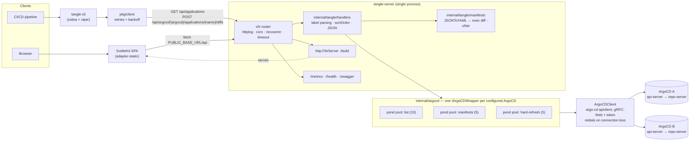

# Internals

How the pieces fit together at runtime. For the technology choices and the reasoning behind them, see [Architecture](../architecture.md) ([published](https://ivanklee86.github.io/tangle/architecture/)).

Tangle is a stateless fan-out proxy in front of N ArgoCD API servers. A single Go binary ([`tangle-server`](https://github.com/ivanklee86/tangle/blob/main/cmd/tangle-server/main.go)) serves the REST API, an embedded Swagger UI, Prometheus metrics, and the pre-built static SPA. A second binary ([`tangle-cli`](https://github.com/ivanklee86/tangle/blob/main/cmd/tangle-cli/main.go)) consumes that same API so pipelines and humans have feature parity.

## Topology

## Request paths

- **`GET /api/applications?labels=k:v&excludeLabels=k:v`** — validates both parameters (`internal/tangle/labels.go`), then fans out over every configured ArgoCD, translating labels into a single Kubernetes selector (`k=v,k!=v`, sorted so the string is deterministic), and returns per-instance results ordered by `sortOrder`. Deep links back into each ArgoCD UI are synthesized from the instance address and scheme (`http`/`https`, from that instance's `plainText`/`insecure` config). A malformed segment, a key repeated within a parameter, or a key shared between both parameters at the same value is a `400` before any fan-out — see [ADR 0026](../adrs/0026-reject-malformed-label-query-parameters.md). The selector is attached whenever *either* map is non-empty, so an exclude-only query filters rather than listing everything.
- **`GET /api/applications`** also returns each application's `sources` (position, kind, repo, path or chart, `ref`, `targetRevision`, and for a `ref` source `usedBy`: the positions of the sources whose Helm `valueFiles` or `fileParameters` read `$<ref>/...` through it). `liveRef` stays `spec.source.targetRevision`, so it's empty for a multi-source application.
- **`POST /api/argocd/{argocd}/applications/{name}/diffs`** — reads the application with a plain `Get` and plans which sources get the target ref (`argocd.PlanRevisions`, [ADR 0032](../adrs/0032-choose-multi-source-revisions-by-target-repo.md)). The ref goes to every source whose normalized `repoURL` matches one of the request's `targetRepos`, or the app's single git repo when `inferTargetRepo` is set. An app none of whose sources match is `notAffected`. A multi-source app with no target repo is `needsTargetRepo`, which also sets `manifestGenerationError` so older CLIs still fail under `--fail-on-error`. Neither is rendered, and neither costs a hard refresh. Otherwise the handler submits a `refresh=hard` `Get` on the hard-refresh pool, then generates both sides concurrently on the manifests pool, converts each to YAML, and shells out to `diff -uNar` over two tempfiles. A single-source application sends `Revision` (`liveRef`, then `targetRef`), exactly as before. An application written with `spec.sources` sends `Revisions` with every `SourcePosition` on both sides, even when the list has one entry, because ArgoCD ignores `Revision` for any `spec.sources` and an explicit render differs from a default one. A one-entry list is still chosen like a single source, so it never needs a target repo. The response carries `status`, per-source `sources` with the revision each side used, the resolved `targetRepos` and, for `needsTargetRepo`, `candidateRepos`. A render that fails after planning still returns `sources` with `status: error`, because ArgoCD's error rarely says which source failed and the usual cause is the target ref missing from a repo it was sent to ([#293](https://github.com/ivanklee86/tangle/issues/293)). The Diffs page names those sources under the error and shows the Sources panel. Each diff logs its plan (positions and revisions per side) and counts towards `tangle_diffs_total{argocd,status}`.

Every pool is a [`alitto/pond`](https://github.com/alitto/pond) worker pool sized per-instance via config; this is the throttle that keeps Tangle from overwhelming ArgoCD's `repo-server`. Pools are registered as Prometheus `GaugeFunc`/`CounterFunc` collectors labeled `pool` + `argocd` (`internal/argocd/metrics.go`), unless `DoNotInstrument` is set.

## Connections to ArgoCD

`ArgoCDClient` sets `GRPCWeb: true`, so argo-cd's apiclient never dials ArgoCD directly: it starts a local gRPC → gRPC-Web reverse proxy on a unix socket (`/tmp/argocd-<random>.sock`) and points the gRPC client at that. Every RPC goes client → socket → proxy → gRPC-Web → ArgoCD. gRPC-Web is hardcoded rather than configurable because Tangle can't know whether a given ArgoCD sits behind an ingress that carries native gRPC.

That connection can't re-establish itself — argo-cd's `BlockingNewClient` dials once and reuses the same `net.Conn` for every subsequent "dial" — so the client owns recovery. Each `ArgoCDClient` holds one connection behind a mutex; an RPC that fails with `codes.Unavailable`, or `codes.Canceled` while its request context is still live, triggers one redial and one retry. Concurrent failures from a pool fan-out collapse into a single redial via a generation counter, and the replaced connection is closed, which is what stops the old proxy and unlinks its socket. `Close()` does the same at shutdown. Dials are counted by `argocd_client_dials_total{argocd,reason,result}` and `argocd_client_connection_generation{argocd}` — unlike the pool collectors, these are always registered. See [ADR 0025](../adrs/0025-reconnect-the-argocd-grpc-client.md).

A reverse proxy in front of ArgoCD (an ingress or load balancer) occasionally cuts a gRPC-Web response off partway through. argo-cd's proxy reports that as `codes.Unknown` with the message `unexpected EOF`, and nothing in argo-cd retries it. The same retry loop therefore also repeats a call whose `Unknown` message is, or ends with, `unexpected EOF`, `: EOF` or `connection reset by peer`. It stays on the same connection, retries at most twice, and backs off about 100 ms times the attempt number, with jitter. Every RPC here is a read, so repeating one is safe. Retries of both kinds are counted by `argocd_client_retries_total{argocd,method,reason}`. See [ADR 0028](../adrs/0028-retry-transient-argocd-transport-failures.md).

A client whose first dial fails is kept and connects lazily on first use, so an ArgoCD that's briefly down at boot doesn't take the pod with it. A missing `authTokenEnvVar` is still fatal for that instance: `internal/tangle/server.go` logs it and skips registering a wrapper for it.

## Configuration

[`koanf`](https://github.com/knadh/koanf) layers, last wins: struct defaults → YAML at `TANGLE_CONFIG_PATH` → `TANGLE_`-prefixed env vars (`_` → `.`). ArgoCD auth tokens are never in the config file — each instance names an env var (`authTokenEnvVar`) read at client construction.

Env var names are resolved against `TangleConfig`'s `koanf` tags, reflected into a key tree at startup (`internal/tangle/envkeys.go`): a variable that names no key is dropped and recorded in `IgnoredEnvVars`, which `New` logs once at `WARN`, and one that does is rewritten to the tag's own spelling (`TANGLE_LISTWORKERS` → `listWorkers`) so it overrides the file's key instead of landing beside it. A segment under `argocds` is matched against the instance names already loaded from the YAML (koanf's `MapKeys`), without regard to case and over the rest of the variable name, longest name first, so `TANGLE_ARGOCDS_PROD_ADDRESS` reaches `Prod` and `TANGLE_ARGOCDS_PROD_EU_ADDRESS` reaches `prod_eu`. A variable naming no existing instance is ignored and reported like any other unknown key, instead of creating a second, half-configured instance ([#237](https://github.com/ivanklee86/tangle/issues/237)). The filter exists because Kubernetes injects `<SERVICE>_PORT_<port>_<proto>_ADDR`-style vars for every Service in the pod's namespace, and a Service named `tangle` collides with this prefix — see [ADR 0023](../adrs/0023-resolve-env-var-overrides-against-the-config-schema.md).

The CLI uses [`cobra`](https://github.com/spf13/cobra)/[`viper`](https://github.com/spf13/viper) with the same `TANGLE_` prefix. A list in the CLI's `tangle.yaml` (`target-repo`, `label`, `exclude-label`) reaches its flag item by item through `pflag.SliceValue.Replace`; anything else is set as one value, and a flag on the command line always wins.

`tangle-cli generate-manifests` is the CLI's only subcommand, and one run produces both manifests and diffs. For each matched application it writes `manifests-<argocd>-<app>.yaml` and `diff-<argocd>-<app>.yaml`, plus `error-<argocd>-<app>.txt` when manifest generation fails or the application needs a target repo. `--target-repo` (repeatable) and `--infer-target-repo` choose which sources of each application get `--target-ref`. The results table gains a Status column only when some diff is not affected or needs a target repo, so an ordinary run prints the same table as before. Files go to `--folder`, or to the working directory when that flag is left out. A generation error only makes the CLI exit non-zero with `--fail-on-error`; a failure to reach the server always exits 1.

## Live test fixtures

The live stack (`task services:cicd`) seeds the four Applications in `integration/kubernetes/example/`. Their manifests live in a separate repo, [`ivanklee86/tangle-integration-manifests`](https://github.com/ivanklee86/tangle-integration-manifests), which ArgoCD reads from GitHub rather than from the local checkout. Its `main` branch is the live baseline that every Application tracks. Its `test_gitops` branch, exactly one commit ahead, stands in for "a change the user pushed": it enables `test-1`'s ingress (so its diff adds one `Ingress`) and deliberately breaks `test-3`'s `values.yaml` (so manifest generation fails), leaving `test-2` and `test-4` unchanged. Every Application auto-syncs except `test-3`, whose manifests at `main` fail to apply, so it is the one app that stays `Missing`/`OutOfSync`. The scenario tests for [test_cases.md](test_cases.md) (`cmd/tangle-cli/main_e2e_test.go`, `web/e2e/live/ci-scenarios.spec.ts`) and the other live suites rely on exactly this. Changes to that repo take effect immediately for every Tangle branch, so change it together with the tests; its README has the rules.

A second set of fixture Applications, in `integration/kubernetes/sources/`, covers the other ways an Application can get its manifests. These are a Tanka app rendered by a config management plugin, a chart from a Helm repo, and six multi-source apps: a Helm-repo chart with git values through `ref`, a git chart with a `ref` source that also has a `path`, sources from two repos, one repo at a branch and at the tag `fixture-pinned-v1` (spelled with and without `.git`), a Tanka source next to a plain one, and sources from three repos (podinfo, this repo pinned to `309da00`, and the manifests repo). `three-repos` deploys to its own `three-repos` namespace, because its resources would otherwise clash with `two-repos'` and `test-4's` in `default`. They auto-sync, so the cluster runs what they render. They sit in their own AppProject, `sources`, which only the `automationSources` token can see. That token is the `sources` ArgoCD in `integration/tangle.yaml`, so these apps never show up in the scenario apps' queries or counts. The Tanka plugin runs as a repo-server sidecar (`integration/kubernetes/argocd/values.yaml`, `templates/plugin-tanka.yaml`), copied from `ivanklee86/homeops`. `TestE2E_SourceFixtures` (`internal/argocd/fixtures_e2e_test.go`) checks each one against ArgoCD directly. It also pins down how `GetManifests` picks revisions: a multi-source app ignores `Revision` and needs `Revisions` paired with `SourcePositions`. Through Tangle, `TestE2E_ServerSourceFixtures` (`internal/tangle/server_e2e_test.go`) and `web/e2e/live/sources.spec.ts` cover listing, live refs, the Tanka diff, a chart-version diff and the Helm-repo branch error. The Go suite diffs each multi-source app with `targetRepos` set to the manifests repo and expects exactly the pushed change (only contains it for `helm-repo-git-values`, whose chart names its Helm test-hook Pods randomly), and also covers "needs target repo", inference, "not affected", extra and ref-less target repos, a missing ref, an empty diff against `main`, and the target ref as the tag `fixture-target` or as `test_gitops's` commit SHA, which the tests look up with `git ls-remote` because every rebase changes it (`TestE2E_CITargetRefKinds` does the same through the CLI). The UI suite checks that without a target repo the multi-source apps say *Needs repo*, that with the manifests repo as `targetRepo` each shows its change and which sources moved, and that the *Needs repo* action adds the candidate to the link and re-runs.

`task argocd:healthcheck` gates the live suites on every ArgoCD Deployment being `Available` and the `argocd-application-controller` StatefulSet being rolled out, not just on `argocd-server`. Manifest generation goes through `argocd-repo-server`, which needs `argocd-redis`, so a server-only wait let e2e start against an unreachable Redis. When the CI e2e job fails, it dumps pod state, events, and ArgoCD logs before the cluster is torn down. `integration/kubernetes/argocd/values.yaml` pulls `argocd-redis` from Docker Hub instead of the chart's default ECR Public mirror, because ECR Public rate-limits anonymous pulls from GitHub's shared runner IPs ([ADR 0030](../adrs/0030-pull-argocd-redis-from-docker-hub.md)). The k3d cluster pins its k3s image and disables k3s's bundled `gateway-api-crd` add-on, so `tasks/k8s.yaml` stays the only source of the Gateway API CRDs ([ADR 0031](../adrs/0031-pin-k3s-version.md)).

## Client IP

Request logs report `client.ip` as the rightmost `X-Forwarded-For` entry, which assumes exactly one trusted proxy in front of Tangle. `resolveClientIP` (`internal/tangle/server.go`) does this with chi's `ClientIPFromXFFTrustedProxies(1)` and then copies the result into `r.RemoteAddr` for httplog. Without the header, or when the rightmost entry doesn't parse, the TCP peer is reported.

## Build

Multi-stage [`Dockerfile`](https://github.com/ivanklee86/tangle/blob/main/Dockerfile): stage 1 runs [`swagger generate spec`](https://goswagger.io/) (the result is `go:embed`ed and served at `/swagger`) then `go build`; stage 2 runs `npm run build` against the [SvelteKit](https://svelte.dev/docs/kit) app; stage 3 is a non-root Alpine image holding `tangle-server`, `tangle-cli`, and `./build`. The server resolves static assets from `./build` relative to its working directory, so the API and the SPA are always the same deploy. Running the binary from a checkout needs `task ts:build` first (`task go:run` does it), and the server logs a `WARN` at startup when `./build/index.html` is missing, since otherwise every UI page is a bare 404.

The frontend is on SvelteKit 3, which has no `svelte.config.js`: the preprocessor, `adapter-static` options, and a `$lib` → `src/lib` alias are all passed to `sveltekit({...})` in `web/vite.config.ts`. The alias is a deprecated stopgap until the imports move to Kit 3's `#lib` subpath imports ([ADR 0029](../adrs/0029-adopt-sveltekit-3.md)). Environment variables have to be declared in `web/src/env.ts`. `PUBLIC_BASE_URL` is declared there as public and static, inlined at build time, and imported from `$app/env/public`. `web/tsconfig.json` extends the generated `$app/tsconfig` and carries its own `include`/`exclude`, because Kit 3 stopped generating them.

Every query field lives in the URL (`web/src/lib/ui/query.ts`), so a link reproduces the page. For multi-source applications that includes a repeated `targetRepo` and `inferTargetRepo=true` ([ADR 0032](../adrs/0032-choose-multi-source-revisions-by-target-repo.md)), which the Diffs page sends with every diff request and the query preview turns into `--target-repo` and `--infer-target-repo`. The client leaves both out of the request when they are unset, so a single-source diff sends what it always did. The outcome of a diff (`web/src/lib/ui/diffs.ts`) reads the server's `status` before its error message, because "needs target repo" sets both. "Not affected" rows are hidden until the sidebar's toggle shows them, and the outcome counts are of the rows listed. The *Needs repo* detail pane's one action adds the picked candidates to the query, which re-runs every diff, because a target repo applies to the whole query. The Diffs page works out which git repos its applications use (`repoUsage` in `web/src/lib/ui/repos.ts`, whose `normalizeRepo` mirrors the server's URL normalization). That list feeds the target repos field's suggestions (a native `<datalist>`), its warning about a target repo no listed application uses, and the "used by N other apps" note on each *Needs repo* candidate. Suggestions come from the applications already loaded rather than a fresh `/applications` call, so they don't follow label edits made in the drawer.

Screenshot tests and the documentation screenshots share `web/playwright.visual.config.ts` ([ADR 0033](../adrs/0033-playwright-screenshot-tests-in-a-pinned-image.md)). Both render a fixture fleet (`web/e2e/fixtures/fleet.ts`): two ArgoCDs, realistic application names, every health, sync and diff status, and a diff responder that follows ADR 0032's planning rules, served through Playwright request routing with nothing that varies between runs. The `visual` project compares screens in light and dark against baselines in `web/e2e/visual/__screenshots__/`. The `docs` project writes `docs/images/Tangle{Home,Applications,Diffs}.png` instead. Both only run through `web/scripts/playwright-docker.sh`, which uses the Playwright image whose tag matches the version in `package-lock.json`, because baselines only match in the environment that made them. The script runs as the host user and keeps the container's `node_modules` and `.svelte-kit` on tmpfs: a container `npm ci` must not replace the host's `node_modules`, and the container's build must not rewrite the `.svelte-kit/generated` files a running `vite dev` reads. Vitest gets its own output folder for the same reason: it runs the SvelteKit plugin in `test` mode, which writes `.env.test`'s empty `PUBLIC_BASE_URL` into the generated env modules, so sharing `.svelte-kit` pointed a running dev server's API calls at itself. `vite.config.ts` sets `outDir` to `.svelte-kit-vitest` under Vitest. CI's `visual` job runs the same script on the amd64 runner and uploads the diff images when it fails.
